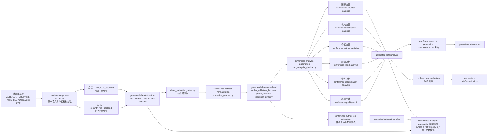
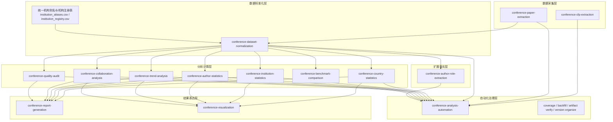

# 项目框架图

本文档基于当前仓库主线代码整理，重点反映“统一抽取 -> 标准化 -> 分析 -> 报告/可视化 -> 自动化治理”的实际结构。

## 1. 总体框架图



## 2. 模块分层图



## 3. 当前仓库的核心主线

当前最明确、耦合最稳定的主线是：

1. `conference-paper-extraction/scripts/run_unified_pipeline.py`
2. `conference-paper-extraction/scripts/clean_extraction_noise.py`
3. `conference-dataset-normalization/scripts/normalize_dataset.py`
4. `conference-analysis-automation/scripts/run_analysis_pipeline.py`
5. `conference-report-generation/scripts/generate_report.py`
6. `conference-visualization/scripts/generate_visualizations.py`

对应统一产物出口：

- `generated-data/extraction/`
- `generated-data/normalized/`
- `generated-data/analysis/`
- `generated-data/reports/`
- `generated-data/visualizations/`

## 4. 目录视角简图

```text
llm_conference_skill/
├── conference-paper-extraction/        统一抽取主入口
├── conference-dataset-normalization/   标准化
├── conference-analysis-automation/     主流程编排与治理
├── conference-country-statistics/      国家统计
├── conference-institution-statistics/  机构统计
├── conference-author-statistics/       作者统计
├── conference-trend-analysis/          趋势分析
├── conference-collaboration-analysis/  合作分析
├── conference-quality-audit/           质量审计
├── conference-report-generation/       报告生成
├── conference-visualization/           可视化生成
├── conference-author-role-extraction/  作者角色补充
├── conference-cfp-extraction/          CFP 信息抽取
├── conference-benchmark-comparison/    横向对比分析
└── generated-data/                     统一结果目录
```

## 5. 一句话理解

这个项目本质上是一个围绕“顶会论文作者-机构-国家事实表”构建的数据工程仓库：上游负责多源抽取，中游负责规范化建模，下游负责统计分析、质量审计、报告生成与可视化输出，而 `conference-analysis-automation` 充当总调度与治理中枢。
