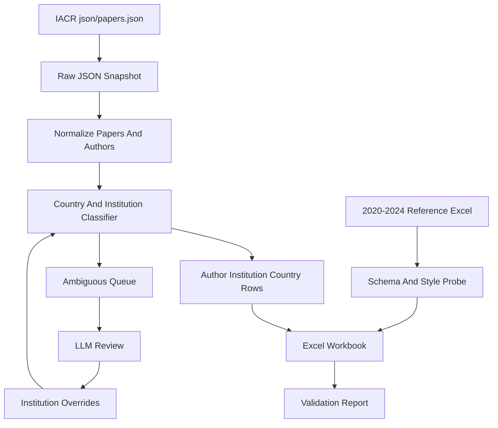

# 三大密码会数据采集计划（历史美国机构兼容方案）

> 说明：这份文档记录的是旧 `Top3-data/` 阶段围绕美国机构兼容切片设计的方案。
> 当前仓库正式主契约已经切换为“作者-机构-国家”长表；文中的美国机构口径应理解为历史兼容切片，而不是当前默认主输出。

## 目标

在 `Plan/` 中先沉淀一套可执行规划，后续执行时采集以下会议中美国机构相关作者发表情况，并输出与 [`/Users/fzy/Documents/code/Top3-data/2020-2024三大密码会.xlsx`](/Users/fzy/Documents/code/Top3-data/2020-2024三大密码会.xlsx) 的 `英文版` sheet 对齐的英文长表：

- Asiacrypt 2025: `https://asiacrypt.iacr.org/2025/json/papers.json`
- Crypto 2025: `https://crypto.iacr.org/2025/json/papers.json`
- Eurocrypt 2026: `https://eurocrypt.iacr.org/2026/json/papers.json`

历史兼容切片口径按“美国机构”执行：只要作者 affiliation 判定为美国机构，该作者行计入；不按国籍或个人身份推断。当前主链路则应保留所有国家的作者机构记录，并把 `country` 作为正式主字段。

## 已确认的参考格式

参考 Excel 位于 [`/Users/fzy/Documents/code/Top3-data/2020-2024三大密码会.xlsx`](/Users/fzy/Documents/code/Top3-data/2020-2024三大密码会.xlsx)，有两个 sheet，但本任务只整理英文版：

- `中文版`: `姓名`, `年份`, `论文标题`, `作者顺序`, `机构`
- `英文版`: `name`, `year`, `article_tag`, `author_order`, `inst`

行粒度是“作者级”，不是“论文级”。`article_tag` 历史数据里既有 `ASIACRYPT-2020-13` 这类编号标签，也有 `ASIACRYPT-A Simple and Efficient Framework of Proof Systems for NP` 这类论文标题标签。新数据只输出英文版字段，并按你的要求使用论文标题生成 `article_tag`，格式为 `ASIACRYPT-<title>`、`CRYPTO-<title>`、`EUROCRYPT-<title>`。`paperId` 只保留在审计字段和中间结果中，不进入主表 `article_tag`。

## 推荐方案

采用“Python 规则引擎 + LLM 疑难复核 + 人工可审计中间结果”的方案。

优点是稳定、可复现、成本低：IACR JSON 已提供 `acceptedPapers[].title/authors/affiliations/paperId`，Python 负责抓取、标准化、作者机构对齐和输出；LLM 只处理无法规则判定的机构，如缩写、公司实验室、多地点机构。所有原始 JSON、规范化 CSV、疑难项、LLM 输入输出、最终 Excel 都保留。

不建议把 LLM 作为主解析器，因为会议页面和 JSON 已经结构化，LLM 主导会降低可复现性。也不建议从 `acceptedpapers.php` 静态 HTML 直接爬取，因为该页面依赖前端加载 `json/papers.json`，无 JS 抓取时会出现“not available”或“papers.json malformed”的误导文案。

## 目录规划

执行阶段建议创建以下结构：

```text
Plan/
  top3_us_institutions_workflow.md

data/
  raw/
    asiacrypt_2025_papers.json
    crypto_2025_papers.json
    eurocrypt_2026_papers.json
  interim/
    papers_normalized.csv
    author_affiliations_expanded.csv
    institution_classification_candidates.csv
    us_institution_candidates.csv
    affiliation_resolution_queue.csv
    llm_resolution_input.jsonl
    llm_resolution_output.jsonl
  reference/
    institution_country_overrides.csv
  output/
    2025-2026三大密码会_作者机构国家.xlsx
    2025-2026三大密码会_作者机构国家.csv
    2025-2026三大密码会_美国机构.xlsx
    2025-2026三大密码会_美国机构.csv

scripts/
  fetch_iacr_papers.py
  normalize_iacr_papers.py
  classify_country_and_institutions.py
  classify_us_institutions.py
  build_workbook.py
  validate_outputs.py
```

## 数据流



## 会议特点与处理策略

- Asiacrypt 2025: 以 `json/papers.json` 为准；页面静态文案可能显示未发布。机构名里亚洲高校和多机构缩写较多，美国机构通常能通过大学、公司、实验室名识别，疑难项进入复核队列。
- Crypto 2025: 会议在美国举办，但统计不能把举办地当作美国机构依据。只按作者 affiliation 判定，避免把非美国机构误计入。
- Eurocrypt 2026: 年份跨到 2026，输出 `article_tag` 使用 `EUROCRYPT-<title>`；页面静态文案同样不能作为无数据依据。

## 机构归属判定规则

第一层规则判定：

- 明确美国高校、公司、国家实验室、研究机构计入，如 `MIT`, `UC San Diego`, `Stanford University`, `Princeton University`, `IBM Research`, `Google`, `NIST`, `SRI`, `Carnegie Mellon University`。
- 明确非美国地名或机构不计入，如 `ETH Zurich`, `University of Luxembourg`, `Ruhr University Bochum`。
- 多机构作者只要任一机构为美国机构即计入，`inst` 保留该作者完整机构字符串。
- 机构列表少于作者列表时，不盲目按索引拆分，标记为“paper-level affiliations uncertain”，进入复核。

第二层 LLM 复核：

- 输入只包含机构字符串、论文标题、作者名和会议标签。
- 输出固定 JSON：`country`, `is_us_institution`, `normalized_institution`, `reason`, `confidence`, `needs_manual_review`。
- 只有 `confidence >= 0.8` 且 `needs_manual_review = false` 的结果可自动写入 override，其余保留人工复核。

其中 `classify_us_institutions.py` 与相关 `*_美国机构.*` 输出应理解为历史 compatibility-only 命名；当前默认主链路应优先围绕泛化国家判定与“作者-机构-国家”长表组织。

## 中间结果与文档记录

每次执行都保存：

- 原始 JSON 快照，带抓取时间、URL、HTTP 状态、内容 SHA256。
- 规范化论文表：会议、年份、paperId、title、authors_count、affiliations_count。
- 作者机构展开表：一行一个作者，包含 `author_order` 和原始 affiliation。
- 泛化机构候选表：规则命中、待复核与未解析三类。若仍需兼容旧流程，可额外保留美国机构子集候选表。
- LLM 输入输出 JSONL，保证可追踪。
- 校验报告：总论文数、总作者行、已解析国家作者行、未解析国家作者行、疑难项数量、作者数与机构数不匹配的论文。

## 输出约束

最终 Excel 至少包含一个主 sheet：

- `英文版`: 字段与参考表一致。`name/year/article_tag/author_order/inst` 均按参考格式输出。

建议额外生成一个审计 sheet 或 CSV，但不改变主 sheet 字段：

- `conference`, `paper_id`, `title`, `country`, `is_us_institution`, `classification_source`, `classification_confidence`

## 验证标准

- 三个原始 JSON 均成功保存，或失败时有明确错误文件和重试记录。
- 每篇论文的 `article_tag` 由会议简称和论文标题生成，唯一且可通过审计字段追溯到会议和 `paperId`。
- 输出主表字段与参考 Excel 的 `英文版` sheet 完全一致。
- 任何自动判定的国家与机构归属都应有规则或 override 来源。
- 作者数量和机构数量不一致的论文不会静默错配。
- 重跑脚本在相同 raw JSON 和 override 下生成一致输出。

## 主要风险

- IACR 站点可能对普通 Python 请求返回 403。执行时应先实现浏览器式 headers 和重试；仍失败时可用已保存 raw JSON 或浏览器下载作为输入。
- `authors[]` 与 `affiliations[]` 有时不是一一对应关系。计划中必须保留 mismatch 队列，不能为了凑表强行对齐。
- “美国机构”不是“美国人”。计划已按机构口径约束，避免使用国籍推断。
- 本任务只整理英文版，不做人名或机构中文翻译，避免翻译引入错误。
